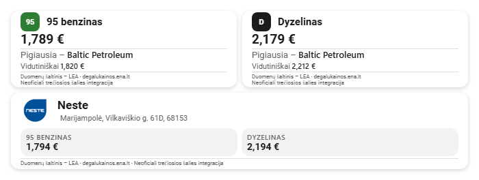
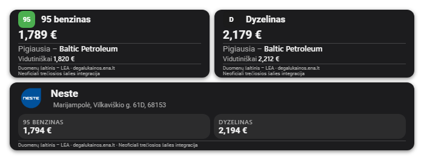

# Degalų kainos Lietuvoje (Home Assistant integracija)

[](https://my.home-assistant.io/redirect/marketplace_repository/?owner=richka&repository=ha-lt-fuel-prices&category=integration)
[](https://my.home-assistant.io/redirect/config_flow_start/?domain=lt_fuel_prices)

**English:** A custom Home Assistant integration for fuel prices in Lithuania.
It uses the Lithuanian Energy Agency (LEA) public fuel price data source
<https://degalukainos.ena.lt/> and provides municipality-level sensors and a
bundled dashboard card. Not affiliated with or endorsed by LEA.

---

Nepriklausoma trečiosios šalies integracija, kuri iš **Lietuvos energetikos
agentūros (LEA)** degalų kainų duomenų paima pasirinktos savivaldybės (ir
nebūtinai miesto) degalinių kainas ir pateikia jas kaip Home Assistant sensorius
bei kortelę.

> **Duomenų šaltinis** – Lietuvos energetikos agentūra (LEA),
> <https://degalukainos.ena.lt/>. Pirminiai degalų kainų duomenų teikėjai –
> degalines valdančios įmonės.
>
> **Neoficiali trečiosios šalies integracija.** Tai nepriklausoma trečiosios
> šalies sukurta integracija. Už jos veikimą, duomenų nuskaitymą, atnaujinimą ir
> atvaizdavimą integracijoje atsako jos kūrėjas. LEA šios integracijos nekuria ir
> neadministruoja.

## Išvaizda

**Šviesi tema**



**Tamsi tema**



*Pavyzdiniai duomenys.*

## Funkcijos

- Viena integracija vienai savivaldybei; galima kurti kelias
  (Marijampolė, Vilnius, …).
- Miesto filtras pagal adreso pradžią; numatoma reikšmė pasiūloma automatiškai,
  ją galima pakeisti diegimo metu arba vėliau parinktyse.
- Suvestiniai sensoriai: **Vidutinė 95-o benzino kaina**, **Vidutinė dyzelino
  kaina**, **Pigiausias 95-as**, **Pigiausias dyzelinas**, **Pigiausia 95-o
  degalinė**, **Pigiausia dyzelino degalinė**.
- Degalinių skaičius, paskutinio atnaujinimo laikas ir duomenų senumo signalas
  (diagnostika).
- Pasirinktinai – atskiri sensoriai pasirinktoms degalinėms. Režimas „Visoms
  degalinėms“ virš 40 degalinių prašo papildomo patvirtinimo.
- Prieigos raktas paprastai gaunamas automatiškai iš LEA svetainės; jei
  nepavyksta, integracija paprašo jo atnaujinti.
- Kai LEA nepaskelbia kainų, integracija kurį laiką rodo paskutines žinomas
  kainas (iki 7 dienų) ir atskirai fiksuoja tikrą atnaujinimo laiką.
- Sąsaja ir sensorių pavadinimai išversti į lietuvių ir anglų kalbas.

## Įdiegimas

<!-- ha-marketplace:exclude-start -->
### Per Marketplace

1. Atidarykite Marketplace nuorodą arba **Nustatymai → Marketplace → Pridėti iš
   nuorodos** ir įveskite `https://github.com/richka/ha-lt-fuel-prices`.
2. Įdiekite **Degalų kainos Lietoje** ir perkraukite Home Assistant, jei prašo.
3. **Nustatymai → Įrenginiai ir paslaugos → Pridėti integraciją → Degalų kainos
   Lietoje**.

### Rankiniu būdu

1. Nukopijuokite `custom_components/lt_fuel_prices` į Home Assistant
   konfigūracijos katalogą: `config/custom_components/lt_fuel_prices`.
2. Perkraukite Home Assistant.
3. **Nustatymai → Įrenginiai ir paslaugos → Pridėti integraciją → Degalų kainos
   Lietoje**.
<!-- ha-marketplace:exclude-end -->

4. Palikite „Gauti prieigos raktą automatiškai“ įjungtą (rekomenduojama).
5. Pasirinkite savivaldybę ir (nebūtinai) miesto filtrą.
6. Jei reikia atskirų degalinių sensorių: integracijos **Konfigūruoti** →
   „Stebimos degalinės“.
7. Savivaldybei pakeisti: integracijos meniu → **Rekonfigūruoti**. Pakeitus
   savivaldybę, miesto filtras ir degalinių sensoriai išvalomi.

## Kortelė

Integracija turi dviejų režimų kortelę:

- **Suvestinė** – pigiausia ir vidutinė pasirinkto kuro kaina.
- **Degalinė** – pasirinktos degalinės logotipas, adresas ir kuro kainos.

Kortelė įtraukiama per prietaisų skydo kortelių parinkiklį („Degalų kainos
Lietoje“). Redaktoriuje galima pasirinkti subjektą – bet kurį sensorį, turintį
`stations` atributą (paprastai `sensor.<miestas>_degalines`) – ir, degalinės
režime, konkrečią degalinę.

### Kortelės konfigūracija

| Raktas | Privalomas | Reikšmė |
| --- | --- | --- |
| `data_entity` | taip | Sensorius su `stations` atributu, paprastai `sensor.<miestas>_degalines`. |
| `mode` | taip | `summary` (suvestinė) arba `station` (degalinė). |
| `fuel` | summary | Kuro rūšis: `95`, `98`, `Dyzelinas` arba `Dujos`. |
| `station` | station | Degalinė formatu `Prekės ženklas - adresas`. |
| `show_logo` | ne | Rodyti degalinės logotipą (numatyta `true`). |
| `show_petrol` | ne | Rodyti benziną (numatyta `true`). |
| `show_diesel` | ne | Rodyti dyzeliną (numatyta `true`). |
| `show_lpg` | ne | Rodyti SND (numatyta `true`). |

Suvestinės kortelė:

```yaml
type: custom:fuel-prices-card
data_entity: sensor.marijampole_degalines
mode: summary
fuel: "95"
```

Degalinių kortelė:

```yaml
type: custom:fuel-prices-card
data_entity: sensor.marijampole_degalines
mode: station
station: "Neste - Marijampolė, Vilkaviškio g. 61D, 68153"
show_logo: true
show_petrol: true
show_diesel: true
show_lpg: false
```

Kortelės apačioje visada matoma šaltinio nuoroda ir žyma „Neoficiali trečiosios
šalies integracija“. Pilnas atribucijos tekstas pateikiamas užvedus pelę.

## Žinomos ribos

- Integracija naudoja viešai prieinamą, bet oficialiai nepaskelbtą LEA duomenų
  šaltinį – LEA gali jį pakeisti be įspėjimo. LEA informavo, kad oficialus
  duomenų šaltinis kuriamas; kai jis bus paskelbtas, integracija bus perjungta.
- 98 benzino LEA neteikia – tik 95, dyzelinas ir SND.
- Savaitgaliais ir švenčių dienomis kainos nesikeičia (rodomi paskutinės darbo
  dienos duomenys); tam skirtas „Duomenų senumas“ signalas.
- Atnaujinimo intervalas – 30 min.

## Duomenų šaltinio nurodymas

Naudojant integracijos rodomus duomenis privaloma nurodyti šaltinį:

> Duomenų šaltinis – Lietuvos energetikos agentūra (LEA),
> <https://degalukainos.ena.lt/>. Pirminiai degalų kainų duomenų teikėjai –
> degalines valdančios įmonės.

Kortelės apačioje visada matoma šaltinio nuoroda ir žyma „Neoficiali trečiosios
šalies integracija“, o pilnas atribucijos tekstas pateikiamas užvedus pelę.
Įrenginio informacijoje rodoma „Degalų kainos Lietoje“, o diagnostikoje –
„Duomenų šaltinis: LEA“; pilnas tekstas ir atsakomybės paaiškinimas yra šio
sensoriaus informacijoje. Integracijos autorius – richka.

> **Atsakomybė.** Tai nepriklausoma trečiosios šalies sukurta integracija. Už jos
> veikimą, duomenų nuskaitymą, atnaujinimą ir atvaizdavimą integracijoje atsako
> jos kūrėjas. LEA šios integracijos nekuria ir neadministruoja.

LEA pavadinimas naudojamas tik duomenų šaltiniui nurodyti. LEA logotipas
integracijoje nenaudojamas.

## Licencija

[MIT](LICENSE). Tai nepriklausoma trečiosios šalies sukurta integracija. LEA šios
integracijos nekuria ir neadministruoja; LEA vardas naudojamas tik duomenų
šaltiniui nurodyti.
